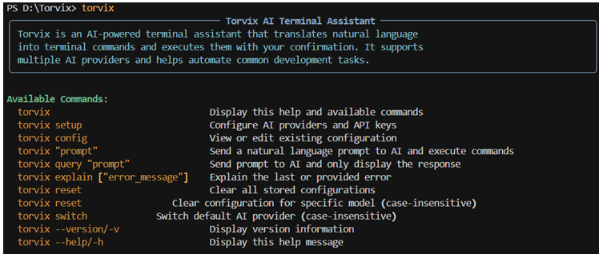
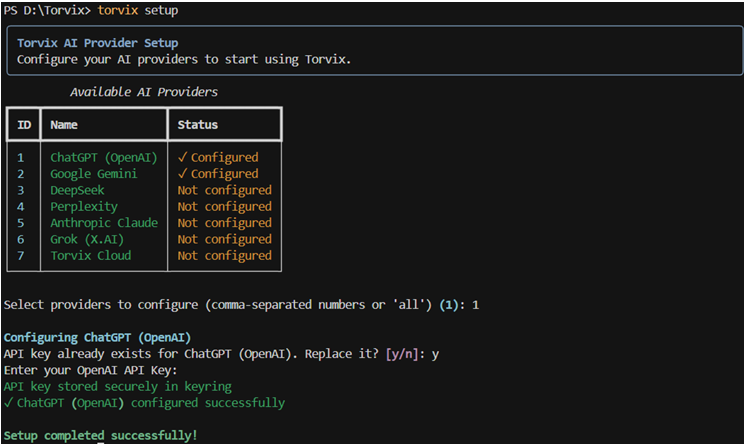
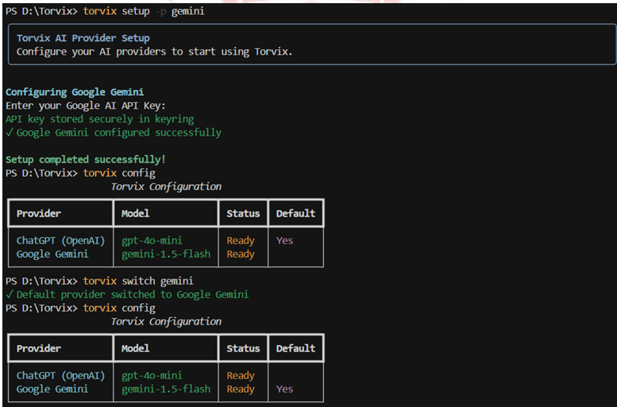
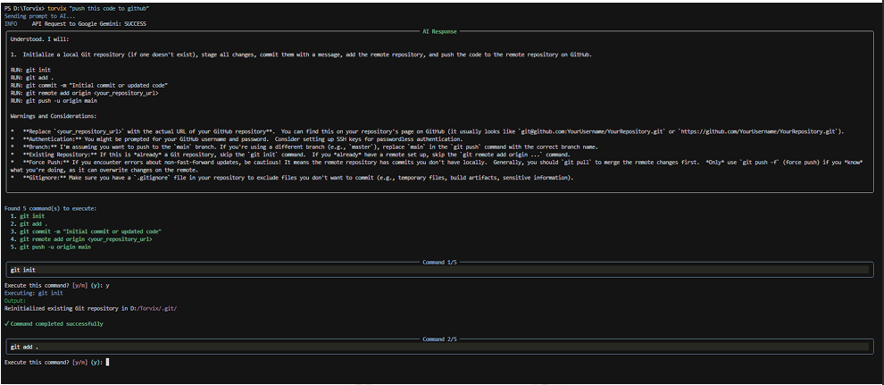

# Torvix — AI-Powered Terminal Assistant 🚀

Torvix translates natural language into terminal commands and runs them safely with your confirmation.

## Screenshots

<table>
  <tr>
    <td>
      
    </td>
    <td>
      
    </td>
  </tr>
  <tr>
    <td>
      
    </td>
    <td>
      
    </td>
  </tr>
</table>


## Key features

- 🤖 **Multiple AI providers**: ChatGPT, Gemini, Claude, DeepSeek, Perplexity, Grok, and Torvix Cloud
- 🔒 **Secure API key storage**: Uses your system keyring
- 🛡️ **Safety-first**: Command confirmation, dangerous-command detection, dry-run mode
- ⚡ **Fast CLI workflows**: Convert everyday language into shell commands
- 🔧 **Easy setup**: Interactive `torvix setup` and `install.py` for quick installation
- 🔒 **Secure API Key Storage**: Uses system keyring for secure credential management
- ⚡ **Natural Language Commands**: Convert everyday language into terminal actions
- 🛡️ **Safety First**: Step-by-step command confirmation with dangerous command detection
- 🎨 **Rich Terminal UI**: Beautiful, colorful output with syntax highlighting
- 🔧 **Easy Configuration**: Interactive setup for all supported AI providers

## Installation

### From PyPI
```bash
# Install Torvix
pip install torvix

# Verify installation
torvix --version
```

### From Source
```bash
git clone https://github.com/torvix/torvix.git
cd torvix
python install.py
```

For detailed installation instructions, see [INSTALL.md](INSTALL.md).

## Quick Start

1. **Setup your AI provider**:
   ```bash
   torvix setup
   ```

2. **Start using natural language commands**:
   ```bash
   torvix "push this code to github"
   torvix "find all python files modified in the last week"
   torvix "create a new branch called feature-auth"
   ```

## Commands

| Command | Description |
|---------|-------------|
| `torvix` | Display help and available commands |
| `torvix setup` | Configure AI providers and API keys |
| `torvix config` | View or edit existing configuration |
| `torvix "prompt"` | Send a natural language prompt to AI |
| `torvix reset` | Clear all stored configurations |
| `torvix reset [model]` | Clear configuration for specific model |
| `torvix --version` | Display version information |
| `torvix --help` | Display help message |

## Supported AI Providers

- **ChatGPT (OpenAI)** - GPT-4 and GPT-3.5 models
- **Google Gemini** - Gemini Pro model
- **Anthropic Claude** - Claude 3 Sonnet
- **DeepSeek** - DeepSeek Chat model
- **Perplexity** - Llama 3.1 Sonar models
- **Grok (X.AI)** - Grok Beta model
- **Torvix Cloud** - Our optimized model for terminal tasks

## Configuration

Torvix stores configuration in `~/.torvix/config.json` and API keys securely in your system's keyring.

### Example Usage

```bash
# Git operations
torvix "commit all changes with message 'fix bug'"
torvix "create and switch to a new branch called feature-login"

# File operations  
torvix "find all large files over 100MB"
torvix "backup my project to ~/backups"

# Development tasks
torvix "install dependencies and start the development server"
torvix "run tests and show coverage report"

# System administration
torvix "show disk usage for all mounted drives"
torvix "find processes using port 3000"
```

## Safety Features

- **Command Confirmation**: Every command requires user approval before execution
- **Dangerous Command Detection**: Warns about potentially harmful operations
- **Timeout Protection**: Commands timeout after 60 seconds
- **Dry Run Mode**: Preview commands without executing them

## Contributing

We welcome contributions! Please see our [Contributing Guide](CONTRIBUTING.md) for details.

## License

This project is licensed under the MIT License - see the [LICENSE](LICENSE) file for details.

## Support

- 📖 [Documentation](https://torvix.readthedocs.io/)
- 🐛 [Bug Reports](https://github.com/torvix/torvix/issues)
- 💬 [Discussions](https://github.com/torvix/torvix/discussions)

## Troubleshooting

- If `torvix` is missing after install, ensure the Python scripts directory is on your PATH or rerun:

```bash
python -m pip install --force-reinstall --no-deps --upgrade .
```

- For Windows permission issues, run the installer from an elevated shell or use a virtual environment.


## Development & Packaging

- Use `pyproject.toml` / `setup.py` when packaging or publishing.
- Tests are in `tests/` and are not required to run the installed CLI.


## Files NOT required to run Torvix (safe to remove or ignore)

- `build/`, `dist/`, `*.egg-info/`
- `__pycache__/` and `*.pyc`
- `tests/` and `.pytest_cache/`
- Duplicate packaged copies: `torvix_1/`, `build/lib/torvix/`


If you want, I can also add a `.gitignore` with recommended entries and a cleanup script that safely removes build artifacts — say the word and I’ll add them.
